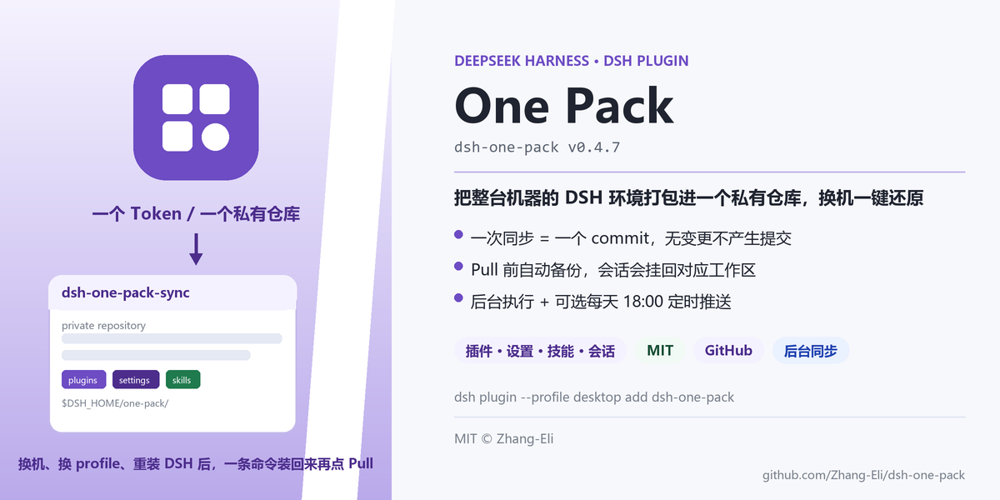
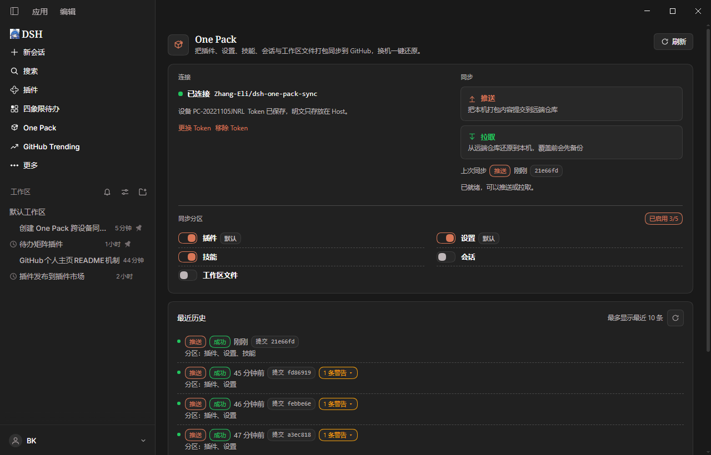

<p align="center">
  
</p>

<div align="center">

[](https://github.com/deepseek-ai/deepseek-harness)
[](https://www.npmjs.com/package/dsh-one-pack)
[](./LICENSE)

</div>

---

## 1. 它是什么

一个 DSH 插件：把一个 DSH 环境（已安装插件、DSH 与插件设置、技能、会话、显式登记的工作区目录）
打包同步到一个**私有 GitHub 仓库**。换机器、换 profile、重装 DSH 之后，装好 One Pack、填一次 token、
点 Pull 就还原，不用再逐个装插件、翻设置、找回会话。

和「手动备份文件夹」的差别在于：

- **一次填 token**：保存后自动创建（或复用）私有仓库 `dsh-one-pack-sync`，不需要先建仓库、再填 owner/repo。
- **Push 前先看计划**：先只读预览新增 / 更新 / 跳过 / 分叉，确认后才真正写入。
- **Pull 前先备份**：将被覆盖的数据先备份到本地，覆盖错了可以回滚。
- **同步在后台跑**：点完确认立即返回，界面不阻塞；完成后写历史、弹结果。
- **会话真的回到工作区**：不只是把文件拉下来，还会挂载到对应 workspace（已存在但未挂载的会话也会补挂）。
- **可以每天自动推送**：默认关闭，打开后每天 18:00（本地时间，可改）自动 Push 一次。
- **多台设备共用一个仓库**：每台设备备份到自己的 `devices/<设备>/` 命名空间，互不覆盖；拉取时可选来源（本设备 / 最新备份 / 指定设备）。

## 2. 效果预览



面板只有一张「连接 + 同步」主卡：左边是连接状态与同步分区，右边是推送/拉取、上次同步和自动推送；
下面是最近 10 次同步历史。没有需要理解的第二层菜单。

| 区域 | 显示什么 |
|---|---|
| 连接 | 已连接 / 未连接、仓库名、设备、Token 状态、更换/移除 Token |
| 同步 | 推送 / 拉取、上次同步时间与 commit、错误与重试 |
| 同步分区 | 插件 / 设置 / 技能 / 会话（工作区文件暂时隐藏）、每项默认值 |
| 自动推送 | 开关 + 时间（默认每天 18:00，本地时间） |
| 最近历史 | 方向、成功/失败、commit、涉及分区、可展开的告警原文 |

## 3. 快速开始

### 3.1 前置条件

| 项 | 要求 |
|---|---|
| Node.js | >= 22（实测 v24.20.0） |
| DSH | >= `0.2.1-rc.5` |
| GitHub | 一个账号；**private** 仓库用于存放环境快照 |
| Token | classic token，勾选 `repo`；面板「生成 Token ↗」已预填 |

不需要自建服务器、额外数据库或系统级计划任务。

### 3.2 安装

从 npm 安装（推荐）：

```bash
dsh plugin --profile desktop add dsh-one-pack
```

本地开发安装：

```bash
git clone https://github.com/Zhang-Eli/dsh-one-pack.git
# 在 DSH 里执行（替换为仓库绝对路径）：
plugin_manager install_bundle("D:/path/to/dsh-one-pack")
```

安装后侧栏出现 One Pack 图标。

### 3.3 首次配置

1. 侧栏打开 **One Pack**，点 **生成 Token ↗** → GitHub 打开 classic token 页（已预填 `repo`）→
   **Generate token** → 把 token 粘回面板 → **保存并创建仓库**。
2. 保存成功后自动创建/复用私有仓库，并显示 `已连接 <owner>/dsh-one-pack-sync`。
3. 打开要同步的分区（默认「插件 + 设置」）。需要换成自己的仓库时，用
   `one_pack_setup { repo: "owner/repo" }` 指定。

### 3.4 在新机器上还原

装好 One Pack → 填同一个账号的 token（同名仓库自动复用）→ 点 **Pull** → 看计划 → 确认。
会话落地后会自动出现在对应工作区；插件安装/更新可能触发重启提醒。
同一仓库可以保存多台设备各自的备份，互不覆盖；新机器上本设备还没有备份，在预览弹窗的「拉取来源」里选 **最新备份**（或指定设备）即可还原。

### 3.5 验证

```bash
curl -s http://127.0.0.1:<dsh-port>/one-pack/api/status
```

或在会话里调用 `one_pack_status`：应看到设备信息、仓库、`hasToken: true`、分区开关与最近同步。
没有 token 时接口返回 401 属正常（Host 只接受带浏览器鉴权的请求）。

### 3.6 会话内工具

除面板外，也可以让 Agent 在会话里直接操作：

| 工具 | 作用 |
| --- | --- |
| `one_pack_status` | 只读状态：仓库、token、设备、各分区开关与最近同步 |
| `one_pack_setup` | 写本地配置：仓库（owner/repo 或 URL）、分支、token、分区开关 |
| `one_pack_sync` | 推送/拉取，两段式（`preview` → `execute`）；`direction=pull` 时可用 `sourceDevice` 选择备份来源（`self` / `latest` / 指定设备 id），execute 自动沿用预览时的选择 |

## 4. 设计取舍

- **link 安装的插件不跨机**：用本地目录（`link:` / `file:`）安装的插件在别的机器不存在，
  拉取后装不回来，所以 One Pack 会主动跳过并提示；想跨机就发布到 npm 或改用 git 安装。
- **Pull 不会盲目覆盖**：写之前先备份；会话内容一致时跳过，本地更新时保留本地，真正分叉时
  本地保留、远端版本另存。
- **同步不产生空提交**：内容按 sha256 比对，没有变化时直接提示「没有需要推送的变更」。
- **默认不碰敏感值**：设置里的 `api_key / token / secret / password` 等字段写成 `***`，
  密钥文件（`.env`、`.key`、`.pem`、`.npmrc` 等）硬排除，token 只保存在 Host 本地。
- **不静默覆盖仓库**：自动建仓只在没配置仓库时触发；同名仓库存在就复用，不会删除或重置。
- **有些变更需要重启**：插件安装/更新、插件启停这类变更要等插件重新加载；Pull 发现这类变更时会弹窗询问。
- **工作区文件分区暂时隐藏**：面板隐藏入口，功能保留，后续按新的交互方式开放。

## 5. 卸载与回滚

```bash
dsh plugin --profile desktop remove dsh-one-pack
```

- 卸载不会删除本地数据：`$DSH_HOME/one-pack/`（state、历史、备份）可以手动保留或删除。
- 远端仓库不会被动；需要清理时由你自己删除 GitHub 上的 `dsh-one-pack-sync`。
- 想回滚某次 Pull：把 `$DSH_HOME/one-pack/backups/<时间戳>/` 里的文件复制回原位置。

## 6. 常见问题

**Token 需要什么权限？** classic token 勾选 `repo` 即可；One Pack 的「生成 Token ↗」已预填。

**为什么某个插件没有被同步？** 它可能是本地目录（`link:` / `file:` / `workspace:`）安装，
别的机器装不回来，One Pack 会主动跳过并提示；发布到 npm 或改用 git 安装后再同步。

**为什么需要重启？** 插件安装/更新、插件启停这类变更要等插件重新加载；Pull 结果发现这类变更时会提示。

**会同步密钥吗？** 不会。设置里的敏感字段脱敏，技能/文件有密钥文件硬排除，token 永不进仓库。

**为什么拉取后会话没出现在工作区？** 看 Pull 结果里的 warning：目标机器没有原工作区目录时，
会话会落到第一个可用工作区；可以在对应工作区里找到它们。

**npm 包页面的 README 为什么和 GitHub 不一样？** npm 展示的是发布时打包的 README；
GitHub 上的更新要等下一次 `npm publish` 才会同步到 npm 页面。

## 7. License

[MIT](./LICENSE) © 2026 Zhang-Eli。`lib/vendor/` 部分版权归 dsh-github-sync 作者所有，详见 [NOTICE](./NOTICE)。