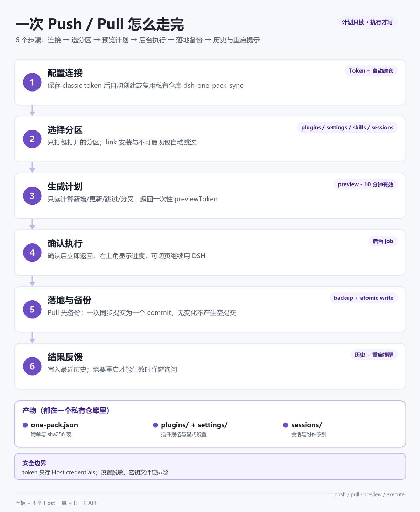

<p align="center">
  
</p>

<div align="center">

[](https://github.com/deepseek-ai/deepseek-harness)
[]()
[](https://www.npmjs.com/package/dsh-one-pack)
[](./LICENSE)

</div>

---

## 1. 它是什么

一个 DSH 插件：把一个 DSH 环境（已安装插件、DSH 与插件设置、技能、会话、显式登记的工作区目录）
打包同步到一个**私有 GitHub 仓库**。换机器、换 profile、重装 DSH 之后，装好 One Pack、填一次 token、
点 Pull 就还原，不用再逐个装插件、翻设置、找回会话。

和「手动备份文件夹」的差别在于：

- **一次填 token**：保存后自动创建（或复用）私有仓库 `dsh-one-pack-sync`，不需要先建仓库、再填 owner/repo。
- **Push 前先看计划**：`preview` 只读，列出新增 / 更新 / 跳过 / 分叉；确认后 `execute` 才真正写入。
- **Pull 前先备份**：将被覆盖的 state / settings / plugins 先落到 `$DSH_HOME/one-pack/backups/<时间戳>/`。
- **一个同步 = 一个 commit**：内容按 sha256 去重，没有变化时直接返回 `NOTHING_TO_SYNC`，不产生空提交。
- **同步在后台跑**：确认后立即返回，界面不阻塞；完成后写历史、弹结果。
- **会话真的回到工作区**：不只是把文件拉下来，还会挂载到对应 workspace（已存在但未挂载的会话也会补挂）。

## 2. 效果预览


面板只有一张「连接 + 同步」主卡：左边是连接状态与同步分区，右边是推送/拉取、上次同步和定时推送；
下面是最近 10 次同步历史。没有需要理解的第二层菜单。

| 区域 | 显示什么 |
|---|---|
| 连接 | 已连接 / 未连接、仓库名、设备、Token 状态、更换/移除 Token |
| 同步 | 推送 / 拉取、上次同步时间与 commit、错误与重试 |
| 同步分区 | 插件 / 设置 / 技能 / 会话（工作区文件暂时隐藏）、每项默认值 |
| 定时推送 | 开关 + 时间（默认每天 18:00，本地时间） |
| 最近历史 | 方向、成功/失败、commit、涉及分区、可展开的告警原文 |

## 3. 过程 / 工作原理



1. **配置连接**：保存 classic token 后，Host 用 `GET /user` 取账号、`GET /repos/{owner}/{name}` 检查
   `dsh-one-pack-sync` 是否存在；不存在才 `POST /user/repos` 创建私有仓库，已存在直接复用。
2. **选择分区**：读取 `state.sections`，只导出打开的分区；`link:` / `file:` / `workspace:` 安装的包
   以及 One Pack 自身会被跳过（别的机器装不回来），并给出一条 warning。
3. **生成计划**：`preview` 只读。push 侧比较远端清单里的 sha256，pull 侧用本地会话 body sha256
   与远端索引 `bodySha` 比较；网络请求只发生在真正需要下载的条目上。
4. **确认执行**：`POST /sync/start` 立刻返回 job，Host 在后台跑 `execute`；面板轮询
   `GET /sync/job?id=`，切到别的页面再回来也会从 `status.activeJob` 恢复提示。
5. **落地与备份**：Pull 先备份将被覆盖的数据；写入先落临时文件再 rename；push 把本次所有文件
   放进一个 commit，没有变化不提交。
6. **结果反馈**：完成后写 `history.jsonl` 并刷新历史；如果结果里 `applied.restartRequired = true`
   （插件安装/更新、启停变化），弹窗询问「立即重启 / 好的」。

产出：

| 产物 | 说明 |
|---|---|
| `one-pack.json` | 根清单：设备、更新时间、分区摘要、每个文件的 sha256 |
| `plugins/bundles.json` | 可复现 bundle 的安装规格、版本、启停；已挂载条目的启停 |
| `settings/config.json` | `configEditor` 中每个条目的显式覆盖，敏感值写成 `***` |
| `sessions/_index.json` + `sessions/<project>/<id>.jsonl.zstd` | 会话索引（含 `originalCwd`）与会话文件 |
| `skills/_index.json` + `skills/<rel>` | 技能文件与 sha256 索引 |

### 3.1 同步分区

| 分区 | 默认 | 同步内容 | 落地方式 |
|---|---|---|---|
| `plugins` 插件 | 开 | 已安装 bundle 的规格、版本、启停；已挂载条目的启停 | `installBundle()` / `setBundleEnabled()` / `setPluginEnabled()` |
| `settings` 设置 | 开 | `configEditor` 中每个条目的**显式用户覆盖**（DSH 设置与插件设置都在这里） | 按条目 id `configEditor.edit()` |
| `skills` 技能 | 关 | `$DSH_HOME/skills/**` | 备份后覆盖写，不删除本地多余技能 |
| `sessions` 会话 | 关 | `session.v4.jsonl.zstd` + 被引用附件 + 工作区注册信息；**跳过已归档会话** | 改 header.cwd → 落盘 → 挂载工作区；body 前缀比较，分叉另存 |
| `files` 工作区文件 | 关 | 显式登记的目录（面板暂时隐藏，Host 实现保留） | 还原到原 cwd，冲突另存 `.remote-<时间戳><扩展名>` |

### 3.2 跨机还原会话

会话目录靠 `sessions/_index.json` 的 `originalCwd` 映射：本机有同路径就用同路径，没有就落到第一个
可用工作区并 warning。会话文件只改头帧里的 `cwd`，正文字节原样保留，所以 append-only 的日志链不会被破坏；
分叉时本地保留、远端版本另存为 `<id>-remote-<stamp>.jsonl.zstd`。

## 4. 快速开始

### 4.1 前置条件

| 项 | 要求 |
|---|---|
| Node.js | >= 22（实测 v24.20.0） |
| DSH | >= `0.2.1-rc.5`（`engines` 声明） |
| GitHub | 一个账号；**private** 仓库用于存放环境快照 |
| Token | classic token，勾选 `repo`；面板「生成 Token ↗」已预填 |

不需要：自建服务器、额外数据库、系统级计划任务。定时推送只在 DSH 运行时生效。

### 4.2 安装

从 npm 安装（推荐）：

```bash
dsh plugin --profile desktop add dsh-one-pack
```

本地开发安装：

```bash
git clone https://github.com/Zhang-Eli/dsh-one-pack.git
# 在 DSH 里执行（替换为仓库绝对路径）：
plugin_manager install_bundle("D:/path/to/dsh-one-pack")
```

安装后侧栏出现 One Pack 图标。One Pack 自己通过 `link:` 安装时不会把自己的安装状态写进远端仓库。

### 4.3 首次配置

1. 侧栏打开 **One Pack**，点 **生成 Token ↗** → GitHub 打开 classic token 页（已预填 `repo`）→
   **Generate token** → 把 token 粘回面板 → **保存并创建仓库**。
2. 保存成功后自动创建/复用私有仓库并显示 `已连接 <owner>/dsh-one-pack-sync`。
3. 打开要同步的分区（默认「插件 + 设置」）。想换仓库可用
   `one_pack_setup { repo: "owner/repo" }` 或改 `$DSH_HOME/one-pack/state.json`。

### 4.4 在新机器上还原

装好 One Pack → 填同一个账号的 token（同名仓库自动复用）→ 点 **Pull** → 看计划 → 确认。
会话落地后会自动出现在对应工作区；插件安装/更新可能触发重启提醒。

### 4.5 验证

```bash
curl -s http://127.0.0.1:<dsh-port>/one-pack/api/status
```

或在会话里调用 `one_pack_status`：应看到设备信息、仓库、`hasToken: true`、分区开关与最近同步。
没有 token 时接口返回 401 属正常（Host 只接受带浏览器鉴权的请求）。

## 5. 工具 / 命令说明

| 工具 | 做什么 | 关键参数 |
|---|---|---|
| `one_pack_status` | 只读：仓库、设备、分区、定时同步、最近同步、待执行计划 | 无 |
| `one_pack_setup` | 写配置：仓库、分支、token（只写不读）、分区、定时同步；可顺手建仓 | `repo` / `branch` / `token` / `sections` / `schedule` / `createRepo` |
| `one_pack_sync` | 两段式同步：`phase=preview` 出计划与 token，`phase=execute` 带同一 token 执行 | `direction`（必填）、`phase`（必填）、`previewToken`、`force` |
| `one_pack_status` | 定时同步也可通过 HTTP `POST /one-pack/api/schedule` 调整 | `enabled` / `time` / `direction` |

HTTP 接口（面板使用，Host 本地鉴权）：

| 方法 / 路径 | 作用 |
|---|---|
| `GET /one-pack/api/status` | 状态、分区、定时、`activeJob`、待执行计划 |
| `GET /one-pack/api/history?limit=10` | 最近同步历史 |
| `POST /one-pack/api/token` / `DELETE` | 保存 / 移除 token（移除会清理所有兼容引用） |
| `POST /one-pack/api/repo/auto` | 自动创建或复用私有仓库 |
| `POST /one-pack/api/state` | 更新 repo / branch / sections / files |
| `POST /one-pack/api/schedule` | 更新定时推送配置 |
| `POST /one-pack/api/sync` | preview，返回 `previewToken` |
| `POST /one-pack/api/sync/start` | 后台执行，返回 job |
| `GET /one-pack/api/sync/job?id=` | 查询后台任务 |
| `POST /one-pack/api/restart` | 重新加载页面（重启提醒的「立即重启」） |

## 6. 配置与目录

本地数据都在 `$DSH_HOME/one-pack/`（`$DSH_HOME` 默认 `~/.dsh`，可用环境变量覆盖）：

| 文件 / 目录 | 作用 |
|---|---|
| `state.json` | 设备 id/名称、仓库、分支、分区开关、`files.paths`、定时同步、上次同步 |
| `history.jsonl` | 同步历史（面板显示最近 10 条） |
| `backups/<时间戳>/` | Pull 前备份的 state / settings / plugins / sessions |
| `restore/<projectKey>/` | 原 cwd 在本机不存在时，工作区文件落到这里 |

远端仓库结构：

```text
one-pack.json                 # 清单：设备、更新时间、分区摘要、文件 sha256 表
README.md                     # 自动生成的可读概览
plugins/bundles.json
settings/config.json
skills/_index.json            skills/<rel>
sessions/_index.json          sessions/<project>/<sessionId>.jsonl.zstd
                              sessions/attachments/<sha>.<ext>
files/_index.json             files/<projectKey>/<rel>
```

## 7. 设计取舍

- **link 安装不跨机**：问题——本地目录安装的插件在别的机器不存在，Pull 后 `installBundle` 会失败。
  做法——导出与拉取都跳过 `link:` / `file:` / `workspace:` 包，只给一条 warning；想跨机就发 npm 或走 git。
- **会话按 body 比较，不按整文件**：镜头帧里的 `cwd` 跨机必然不同，比整文件会把所有会话判成「分叉」。
  做法——只比较头帧之后的 body；写入时只重压头帧，正文原样保留。
- **previewToken 一次性 + 后台 job**：预览和实际执行之间远端可能变化。做法——execute 重新计算计划，
  计划过期或方向不符直接报错；后台 job 让 HTTP 请求立即返回，避免大仓库把界面卡住。
- **没有可靠的进程重启 API**：Electron 桌面端自重启有单实例锁和 argv 风险。做法——「立即重启」只做
  页面 reload，并在弹窗里说明；仍不生效时从应用菜单重启。
- **默认不导出敏感值**：设置里递归匹配 `api_key / token / secret / password / credential / private_key /
  authorization / cookie`，写成 `***`；Pull 时这些字段保留本机值，不写回占位符。
- **工作区文件分区暂时隐藏**：面板隐藏入口，但 Host 分区、`files.paths`、测试全部保留，后续按新交互开放。
- **不静默覆盖仓库**：自动建仓只在没配置仓库时触发；同名仓库存在就复用，不会删除或重置。

## 8. 手动排查 / 本地开发

```bash
node --check index.js client.js
node --test test/*.test.mjs        # 55 个用例，含离线跨机 push/pull 集成测试
node _gate_run.mjs "<仓库绝对路径>" _gate_report.json   # 发布门禁（工作区脚本）
```

| 现象 | 先看哪里 |
|---|---|
| 面板显示已连接但推送 404 | token 是否有效 / 是否有该私有仓库权限；`state.json` 的 `repo` 是否正确 |
| 推送没有历史记录 | 历史在同步完成时写入；看右上角是否仍显示「推送中…」，或 `status.activeJob` |
| 插件拉取后没生效 | 是否需要重启；看 Pull 结果是否 `restartRequired` |
| 拉取会话不在工作区 | 看 warning 里的 `originalCwd` 映射；目标目录不存在时会落到第一个可用工作区 |
| 预览很慢 | 首次全量需要下载远端 blob；之后未变化会话走本地 body sha256 快速路径 |

## 9. 卸载与回滚

```bash
dsh plugin --profile desktop remove dsh-one-pack
```

- 卸载不会删除本地数据：`$DSH_HOME/one-pack/`（state、历史、备份）可以手动保留或删除。
- 远端仓库不会被动；需要清理时由你自己删除 GitHub 上的 `dsh-one-pack-sync`。
- 想回滚某次 Pull：把 `backups/<时间戳>/` 里的文件复制回原位置（state / settings / plugins / sessions）。

## 10. 常见问题

**Token 需要什么权限？** classic token 勾选 `repo` 即可；One Pack 的「生成 Token ↗」已预填。

**为什么某个插件没有被同步？** 它可能是 `link:` / `file:` / `workspace:` 本地目录安装，别的机器装不回来，
One Pack 会主动跳过并提示；发布到 npm 或改用 git 安装后再同步。

**为什么需要重启？** 插件安装/更新、插件启停这类变更要等插件重新加载；Pull 结果发现这类变更时会提示。

**会同步密钥吗？** 不会。设置里的敏感字段脱敏，skills/files 有密钥文件硬排除，token 永不进仓库。

**npm 包页面的 README 为什么和 GitHub 不一样？** npm 展示的是发布时打包的 README；GitHub 上的更新
要等下一次 `npm publish` 才会同步到 npm 页面。

## 11. License

[MIT](./LICENSE) © 2026 Zhang-Eli。`lib/vendor/` 部分版权归 dsh-github-sync 作者所有，详见 [NOTICE](./NOTICE)。

---

- 反馈问题：[GitHub Issues](https://github.com/Zhang-Eli/dsh-one-pack/issues)
- 更新记录：[CHANGELOG.md](./CHANGELOG.md)
- Developed by [Zhang-Eli](https://github.com/Zhang-Eli)